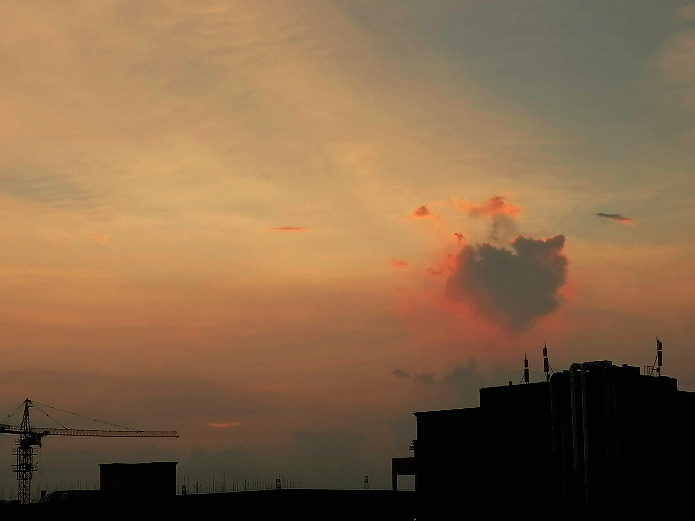
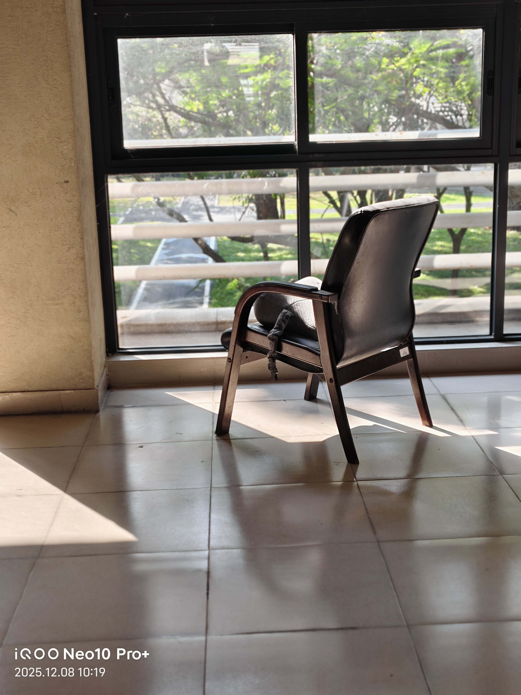
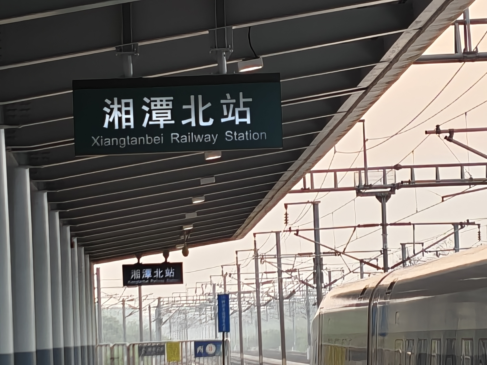

import { Video, Audio } from 'komorebi-theme/components';
import Sacred_Play_Secret_Place from './无题.assets/Sacred_Play_Secret_Place.mp3';

封面图片：《[Tear](https://www.avogado6.com/diary2025?lightbox=dataItem-mlyrlr3v9)》&emsp;|&emsp;作者：アボガド6 (Avogado6)

---

只是一些零碎的思绪。

 

## 关于云

初三那年，我从同学的手里借了一本小说——《云边有个小卖部》。

那是我读的第一本张嘉佳的小说。

有些人觉得张嘉佳的文字很矫情，很有些无病呻吟，又或者有些其他的看法。

不过我觉得对于作品的解读，本来就是各有各的看法。所谓“有一千个读者，就有一千个哈姆雷特”，不同的人有不同的感受是很正常的吧？

无论如何，我觉得我是很喜欢张嘉佳的文字的。

《云边有个小卖部》我看了很多遍，每一次都忍不住落泪。

> 有朵盛开的云，缓缓滑过山顶，随风飘向天边，我们慢慢明白，有些告别，就是最后一面。

这是书中让我感触颇深的文字之一。这之后的许多次，当我再看见云，我总是会有些莫名的感受。

> 一朵云缓缓滑过天边，我想我和它再也不会再见。

有一次在傍晚的天空下，我看见一朵云在缓缓的飘动。那是很大很白的一块云，飘得很慢很慢，给我一种宁静的感受。我看着它安静的飘荡，最后离开了我能看见的天空，随后我就想到了上面这句话。

此后很多次，看见云的时候，都会想起上面这句话。

 

后来有一天，我和爸爸出门去营业厅办理业务，回来的时候因为信息变动，我的电话卡短时间内不能通信。

我坐在后座上，抬起头来，看见夏日晴天。

白云身后的天空湛蓝，扁平的云像是涂抹的色彩，厚大的云像是点缀的装饰。

风拂过我的耳边，云也飘得那样慢。好像一切都不用着急，好像一切都有转机。

许久之前我得知，轻盈的云其实是无数细小的水滴。

然后在这一刻，我突然想到这么一段话：

> 循环不息的水
>
> 会不会我见到的某一朵云
>
> 其实是我久别的泪

---

 

## 0819

2025-08-19

这个世界太大太大，遇见什么样的人，经历什么样的事，都不觉得奇怪。

世界吵闹又冷清，

每一秒都有人在相拥，每一秒都有人在诀别。

在那么多看不见的角落里，

有那么多看不见的故事在上演。

谁与谁携手，谁与谁擦肩。

那么多的泪水，只能自己咽。

 

## 1208

2025-12-08  10:47

上完了雅思课，第二节高数翘掉。回宿舍之前去工学一号交表。

交完表离开的路上经过二楼的休息区。今天的天气不错，我看到玻璃窗户外的阳光很是明媚，还有一些阳光投射进来。空旷的休息区没有人，我看到一张孤零零的椅子。那张椅子看起来有些破旧了，它斜向窗户，而阳光也斜射进来。我在那一刻的某一瞬间感受到了一些说不清道不明的东西，所以我打开相机想要通过拍摄抓住它们。

拍的实在一般。我迫切的想要抓住什么，却在伸手的那一刻发现它们无影无踪。

骑自行车回宿舍的路上，我带着耳机。当我骑到自行车道，耳机播放的是Sacred Play Secret Place.

<Audio src={Sacred_Play_Secret_Place} caption="Sacred Play Secret Place"/>

我很喜欢这首歌，它听起来很宁静。那一刻我好像被一种祥和的气氛包围，感到一种一切都有转机的安心。

我骑在仔自行车道上，车轮碾过一片片枯朽的落叶，发出细微的、清脆的声音。今天的风有点凉，轻柔的吹散我额前的头发，带来一种难以言喻的舒适，就连车道旁绿树的枝叶也在微风中摇曳。

我从一些叫卖着早餐的摊主身后经过，从一些说笑着去向教学楼的同学们身边经过。我听到一声清晰的吆喝“……糯米鸡啦！小笼包啦！……”，我还听到一些模糊的交谈，夹杂着轻笑。这些声音细碎地交织在明媚地阳光下，我莫名地感受到一些踏实，感受到一些生命的鲜活和世界的美好。

我继续向着宿舍骑去，离那些人群越来越远，可那些感受被耳边宁静的旋律带着，轻轻的包围着我，在我身后跟了好久好久……

---

 

## 回车不是换行

2026年3月31日  22点54分

我今天晚上才知道 ，Typora的回车是换段而不是换行。

Enter是换段：

下面换段了，

上面换段了。

双空格然后Shift + Enter才是换行：  
下面换行了，  
上面换行了。

 

## 高三那年

2026年4月6日  02点26分  
半夜刷视频，刷到了一个高三学生的碎碎念。  
看着那个视频，想起自己的高三。  
我在那个视频下评论：  

> 真的真的非常非常辛苦啊。  
> 我是去年参加的高考，考完走出考场的时候，已经有很多同学离开了，剩下一些生物考试的同学们。  
> 我当时特别恍惚。  
> 那时候刚好高一高二的同学们也返校了，我收拾好东西，逆着他们慢慢的往门口走。  
> 夕阳，晚风，行李箱的轮子在马路上滚动。  
> 我感觉好梦幻，几乎不敢相信结束了，我熬过高三了。  
> 我走着走着，忽然忍不住跑起来。  
> 迎着风，一边跑，一边忍不住哭泣。  
> …  
> 不好意思评论了这么多。  
> 看到你的视频，我想起我的高三，那些煎熬，那些焦虑，那些无法言说的苦楚。  
> 真的真的非常非常辛苦啊。  
> 无论如何，我希望你也可以坚持下来，我希望你也可以熬过这些煎熬的时刻，我希望你也可以得偿所愿，取得理想的成绩。  
> 真的真的。

写下这段评论的时候，有些想哭。

 

## “自杀”

睡前看到了一篇[朋友的帖子](https://x.com/kuruminoko096/status/2044418368896430357)  

> 生物（特に人間）である限り集団に帰属するのをやめることなんてできないけど、人間関係全部断ち切って、一人で生きたい。  
> ある意味、自殺っていうのは人間社会に対する帰属意識からの解放だよね  
> あ、別に私は死ねないので死にません

我觉得她思考的角度很有意思。

马克思说”人是社会关系的总和“，那么，”把自己从人类社会中解放“的行为，也就是说，”切断所有社会关系“这一行为，是不是也是一种”自杀“呢。  
作为从社会中诞生的现代人，或许终其一生也无法脱离社会。  
或许这就是所谓的 “在这个世界上，没有一个人是孤岛。”

> 面白い考え方だと思います。  
> マルクスは「人間とは社会的关系の総体である」と言いました。  
> それならば、「人間社会から自分を解放する」という行為は、一種の「自殺」（社会的な死）と言えるのではないでしょうか。  
> 社会から逃れられない現代人は、おそらく永遠に孤島にはなれないのかもしれません。

 

## 湘潭北站

很意外的，CCSSSC2026 晋级区域复赛了。  
虽然只解了一题，虽然初赛华南赛区 178 名，但是还是晋级了。  
区域复赛要到线下赛场参加，地点是湖南省湘潭市湘潭大学。

诚实地说，师兄告诉我“准备公费旅游”的时候，我是很兴奋的 —— 我也可以外出打比赛吗！  
我早早的买好了车票，订好了酒店，并且在此后的好几天时不时就会想起这件事，然后开心一下 —— 这可是公费旅游！

不过，其实我知道，我能够来这里，完全是侥幸。我在这件事情上几乎没有任何贡献。  
我觉得我其实什么都不会，区域复赛就是为了淘汰我这样的的半吊子的。  
不过没关系，不会就不会吧，慢慢学吧，总能学会的。这次来，就当涨涨见识，增加阅历了。  

从学校打车到地铁站，地铁站坐到，或者站到火车站，再一路高铁坐到湘潭北站，几乎是四个小时。  
我已经不记得上次坐长途高铁是什么时候了，这一次坐的我感觉好累啊。  
列车加速的时候，我感受到一种强大的力量，那时候的时速有多少？200km/h？300km/h？我不记得了，只觉得真快啊。  
但是一看时间，还要坐一个小时呢。  
那时候，心里忍不住想：

> 列车已经开的这样快，却还是要开的这样久  
> 这段距离，远比想象的更加遥远  
> 世界真大啊

