import video1 from './湘潭北站.assets/黄色鹦鹉.mp4';
import video2 from './湘潭北站.assets/你会说话吗？.mp4';

封面图片：《[スキマおばけにご注意を](https://www.avogado6.com/diary2025?lightbox=dataItem-mlyrlr4j13)》&emsp;|&emsp;作者：アボガド6 (Avogado6)

---

## 晋级

很意外的，CCSSSC2026 晋级区域复赛了。  
虽然只解了一题，虽然初赛华南赛区 178 名，但是还是晋级了。  
区域复赛要到线下赛场参加，地点是湖南省湘潭市湘潭大学。

诚实地说，师兄告诉我“准备公费旅游”的时候，我是很兴奋的 —— 我也可以外出打比赛吗！  
我早早的买好了车票，订好了酒店，并且在此后的好几天时不时就会想起这件事，然后开心一下 —— 这可是公费旅游！

不过，其实我知道，我能够来这里，完全是侥幸。我在这件事情上几乎没有任何贡献。  
我觉得我其实什么都不会，区域复赛就是为了淘汰我这样的的半吊子的。  
不过没关系，不会就不会吧，慢慢学吧，总能学会的。这次来，就当涨涨见识，增加阅历了。

## 周五

### 出发

正式比赛在周日，大家计划了一下，决定买周五下午的票。  
大概是兴奋的缘故吧，虽然昨晚没有早早睡觉，但是早上起床之后意外的清醒，玩了一会游戏之后我就开始收拾东西。  
收拾好东西之后，我计划带队友们一起吃个饭，然后一起打车去地铁站。

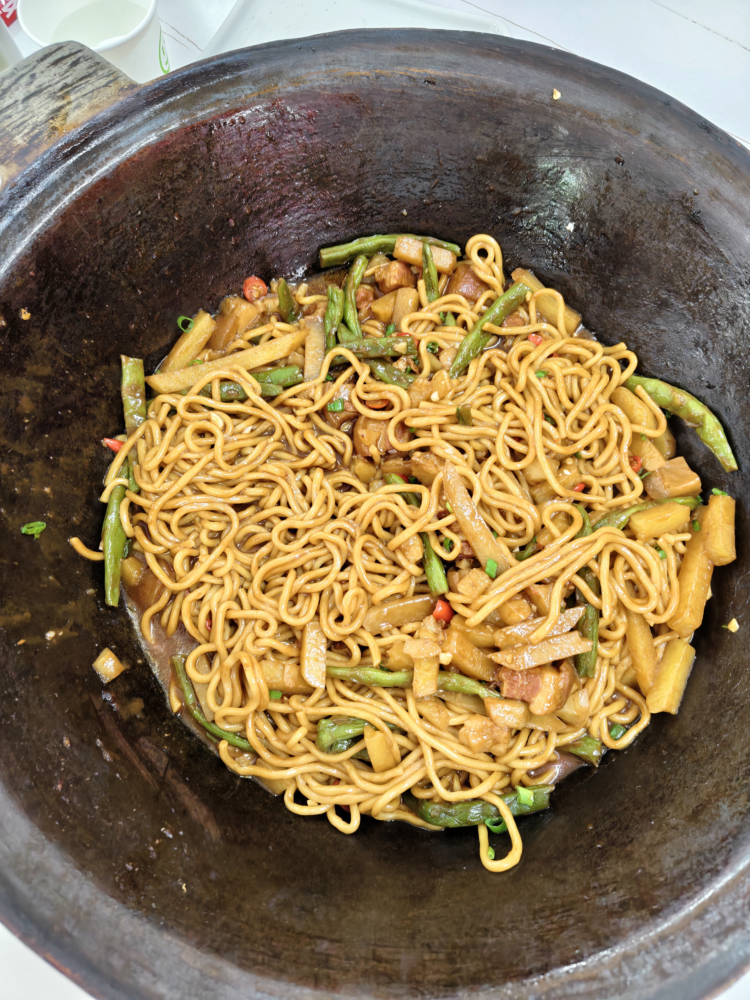

我喜欢吃铁锅焖面！  
我还邀请了时雨和我们一起吃。他还没有收拾好东西，一边吃饭一边还要打电话给焦茶帮他收拾。~~真是个懒家伙~~  
时雨的胃口很小，吃了几口就不吃了，赶回去收拾东西了。  
真的，有的时候我会有些不好意思找他要A的钱。  

从学校打车到地铁站，地铁站坐到（或者说站到）火车站，再一路高铁坐到湘潭北站，几乎是四个小时。  
我已经不记得上次坐长途高铁是什么时候了，这一次坐的我感觉好累啊。  
列车加速的时候，我感受到一种强大的力量，那时候的时速有多少？200km/h？300km/h？我不记得了，只觉得真快啊。  
但是一看时间，还要坐一个小时呢。  
那时候，心里忍不住想：

> 列车已经开的这样快，却还是要开的这样久  
> 这段距离，远比想象的更加遥远  
> 世界真大啊

### 晚饭

到站的时候已经是傍晚了，从火车站打车到酒店又要一段时间，等落脚休息的时候，天已经快黑了。  
在酒店的床上躺了一会，我开始思考一个问题 —— 晚饭吃什么呢？

酒店对面街有一些馆子，不过大家一路走过一遍也没有选出来吃什么好。  
再走远一些，湘潭大学旁边，有一条小吃街，我们决定去那里看看。  
走进小吃街，第一个摊子就是显眼的 “广东肠粉”。我倒是挺喜欢吃肠粉的，不过平时很容易吃到，所以这次就算了吧。而且，这广东肠粉看起来不太象是我平时喜欢吃的那种啊……  
小吃街的摊位很多，但是很多门面都比较狭窄。佩奇师兄回头挥了挥手，“到这里了想吃什么就自己去吃吧。想一起吃应该是不太行了”。  
我原本想着或许我们十三个人可以一起吃饭，现在看来是不太可能了。

但是吃什么呢？  
我不知道，我觉得其他人也不知道。我们几个人茫然地往前走着，走到了一家湘菜馆下。  
LSJGP 说可以吃小炒，于是我们停下了。  
湘菜啊，湘菜不错。湘潭的湘菜会比广州的湘菜更好吃吗？我不知道，不过我觉得可以试试。

七个人，点了五六个菜。  
时雨点了一道水煮酸菜鱼，“这个看起来就很好吃，你试试嘛。”  
我试了，我果然还是不太喜欢。不过他看起来还挺喜欢的，吃完了鱼，还要倒一点鱼汤来喝，喝的津津有味。  
我自己好像点了一份日本豆腐。豆腐的做法有很多，其实大部分我都不太喜欢，但是我喜欢日本豆腐。

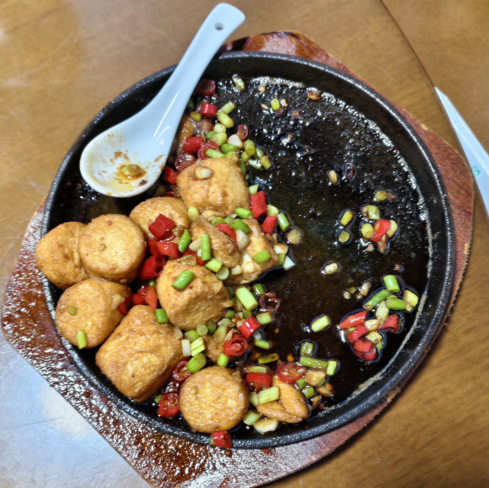

薄薄的皮里面是滑滑嫩嫩的芯，日本豆腐真好吃吧！  
还有一道茄子，但不是我以前常吃的那种，他们好像在茄子上撒了蟹黄。  
唔，大家好像不太喜欢这种做法。茄子上的不晚，但一直留到最后都还有不少。  
我倒是吃了不少，主要的原因是我也很喜欢吃茄子。虽然我也不是很喜欢蟹黄的味道，但是茄子真好吃吧！  
还有一道鸡蛋饼，是一张撒了葱的大薄饼。我尝了几口，觉得不太好吃，主要是没有什么味道啊。

还点了什么菜呢？我不太记得了。不过，我记得大家吃的挺开心的。  
大家在同一个地方，围坐在同一张桌子上，一边夹着自己想吃的菜，一边说着自己想说的话。  
我一直都觉得，这是一件非常美好的事情。

吃完了饭，一些人先回去了，一些人还想再逛逛。  
和 rkk 一起慢慢地走着，走着。  
是因为比广州更北一些吗？我感觉湘潭的夜晚更加凉爽一些。  
时雨忽然从后面追上来了。他说找不到回去的人们，只能和我们一起走了。~~你真的可以自理吗~~  
我觉得和大家一起吹着晚风在夜色里散步是一件很有意思的事情。  
可惜小吃街不大，没有那么多可以逛的地方，而且我也确实有些累了。随便走了走，我们就也回去休息了。

晚上在酒店休息的时候，忽然聊到女装的话题。  
我原本没有怎么留意，但是我看见我的队友在我的面前掏出了一件女装，还有一包像是化妆品的东西。  
然后，他就推着师兄走了，走到另一个房间去了。  
我没有跟上去，我有一些大受震撼，我一直以为这只是个玩笑呢！  
不一会我就在群里看到了一些照片。诚实地说，我觉得其实还挺好看的。  

人生真的是很奇妙不是吗？什么都有可能发生呢。

## 周六

### 鹦鹉

我睡醒的时候，是十一点还是一点？我忘记了。  
对不起，我不是一个早睡早起的人。  
在床上发了一会呆，我有点饿了。  
我在群里发了一条消息，约了一些还没有吃饭的人一起出去吃点东西。  
洗漱完我就去一楼酒店大堂等着了。这个时候我发现大堂有一个鸟笼。看起来像是鹦鹉。

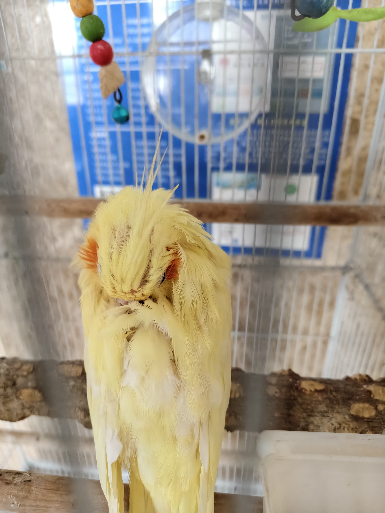  

<video 
  src={video1} 
  controls 
  class="w-3/5 max-w-[500px] rounded-lg mx-auto"
></video>

很可爱的鸟，这个笼子里还有另外一只灰色的。  

<video 
  src={video2} 
  controls 
  class="w-3/5 max-w-[500px] rounded-lg mx-auto"
></video>

这真的是鹦鹉吗？为什么不学我说话啊？  
后来时雨和我说，确实是鹦鹉，但是一般来说，中大型的鹦鹉才会说话，而且要经过训练才行。小型的一般是不会说话的。  
可恶，我还以为鹦鹉是一种想说什么话就说什么话的鸟呢。

### 签到

虽然小吃街不算很远，但我觉得走过去再走回来也不是很轻松的事情。  
我刚从小吃街吃完早餐（或者说午餐）回来酒店坐下，就看到佩奇师兄叫我们集合签到的信息。  
啊……我当时其实感觉有点累，但我想着签个到应该不用多久，所以坐了一下我就又出去了。  
事实证明我是错的，错的离谱。如果能重来，我一定会派我的队友去而不是我自己去。~~队长可以这么用吗？~~  

湘潭大学真的好大，好大，好大……  
我们走了很远，很远，很远。走到一半我看到一个“计算中心”，我还以为到了，没想到计算中心旁边的是土木楼。为什么计算中心旁边的是土木楼啊！  
我看到好多的电动车，看来湘潭大学的同学们平时都是骑电动车出行的。我想也是，毕竟学校那么大，骑电动车是对的。  
但是我没有电动车！  
我一边跟着佩奇师兄走着，一边在想：为什么没有共享电动车……为什么没有共享单车……  
我的天呐，我感觉我在翻山越岭。  
好不容易走到了计算机学院楼（为什么你们的计算机学院楼不在计算中心旁边啊！），签到完领完参赛证和竞赛手册，我们还要再走回去……  
真的，如果能重来，我一定派 huarun 或者其他人去，总之不是我去。

### 喷漆

去湘潭大学的路上，我们经过了一个地下人行横道。通道两侧的墙壁上有许多喷漆。  

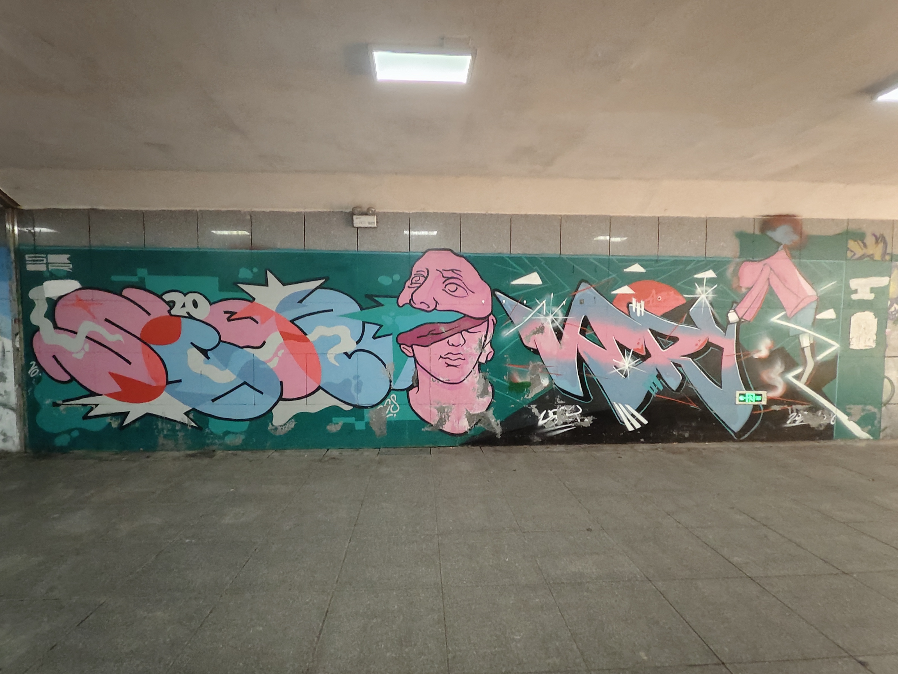

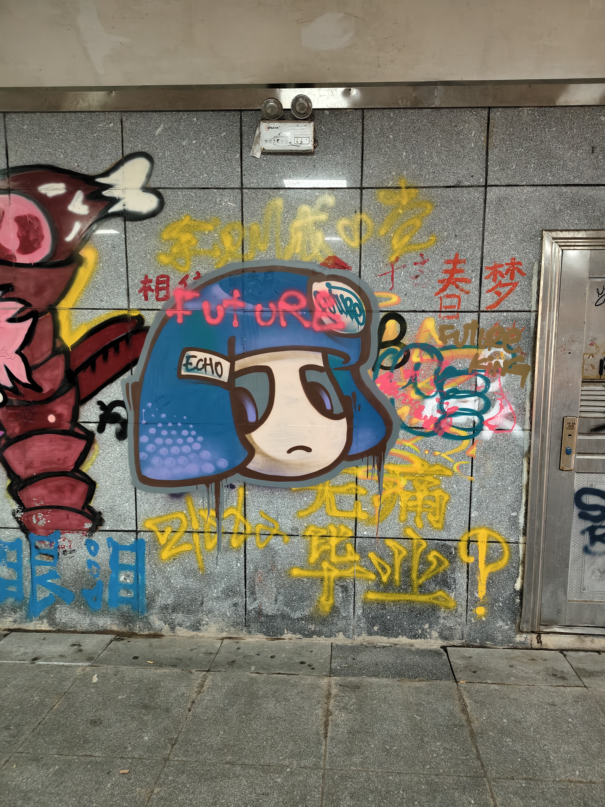

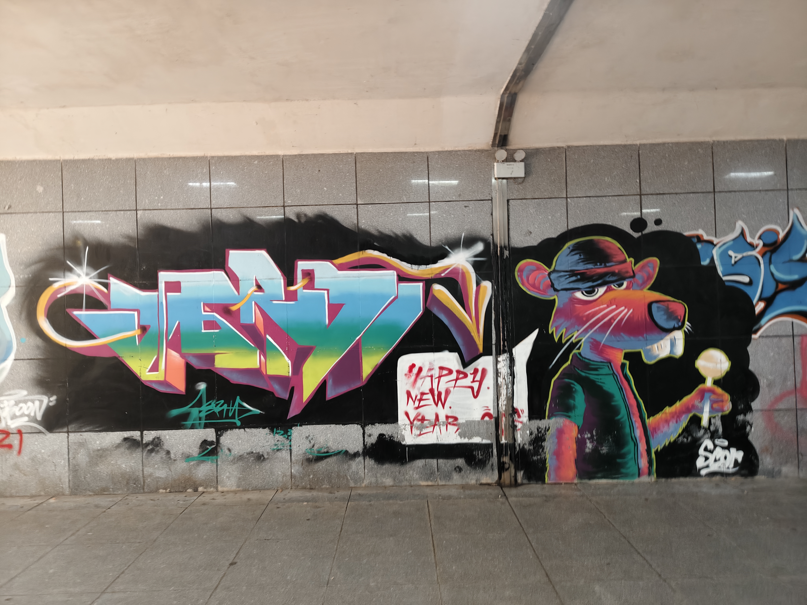

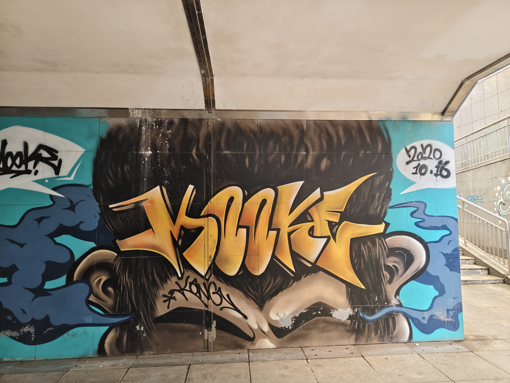

虽然听说过这种文化，但亲眼见到还是第一次。这些都是用喷漆罐喷出来的作品吗？真厉害啊。  
喷漆之中还有一个特别红的作品：

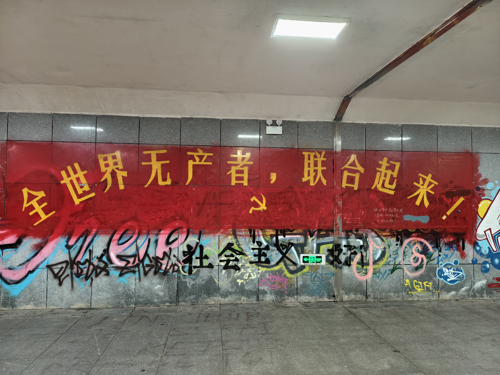

哇哦。

### 测试

回到酒店我就躺下了。虽然早上很晚才起床，但是我还是觉得有些困了。  
睡了多久？不记得了，或许很久吧。等我睁开朦胧的眼，只看见橘黄色夕阳打在床边的墙。  

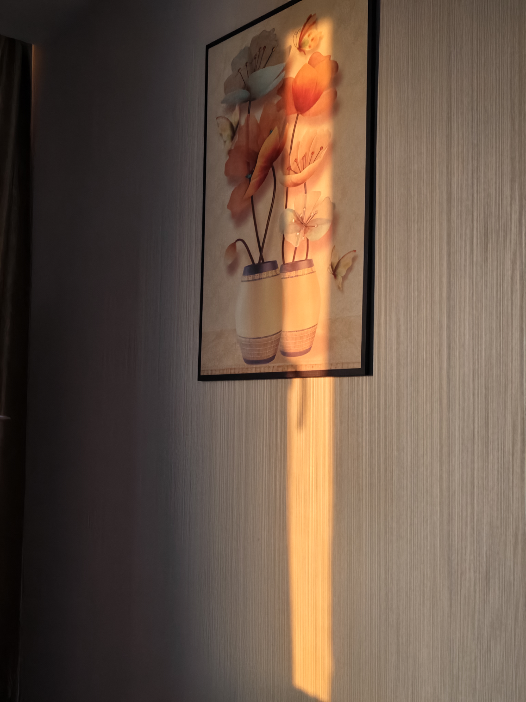

睁开了眼，半梦半醒的发着呆。等起床的时候天已经黑了。  
听说附近好像有个什么展，好多人都去了。但是我下午太累了，一直在睡觉。  
原本打算等他们回来一起吃饭，但是他们好像已经在那边点好菜了。  

时雨和 LSJGP 好像没有去，我看到时雨在群里发他们在玩《土豆兄弟》的照片。我打算叫上他们一起出去吃点东西，于是我敲了敲门。  
时雨给我开了门之后又马上跑回去操作了。他看起来玩的很开心呢，他们不会玩了一下午吧？  
他真的很喜欢玩，我都到他房间叫他了，他还是磨蹭了几局才拿上东西和我们走。

吃完晚饭回到酒店，我收拾了一下，准备带着我的 mac 去明天比赛的场地测试一下。  
主办方说严禁 WIFI ，但是我们有好几台设备没有 RJ45 接口，不得不临时买一些转接口。  
考虑到 mac 的接口比较少，只有两个 Type-C 接口，我就多花了一些钱，一百块买了一个带 RJ45 的拓展坞。  
我要去测试一下这些设备和比赛场地的网线能不能正常工作。

虽然但是，其实我并不是很清楚正式比赛的场地在哪里。不过没关系， rkk 会带我们去的，跟着 rkk 走就好了。  
我觉得 rkk 真的是一个非常可靠的人呢。这一次我订的车票和酒店，也都是跟着 rkk 订的。如果让我自己来做这些事情，肯定会更加手忙脚乱吧。  
湘潭大学真的好大啊，我们辛辛苦苦地走了好一会才终于走到到体育馆。  
然而我们绕体育馆转了一圈也没有找到比赛的场地，在群里问了问才发现我们弄错了地址 —— 比赛场地是“体训馆”而不是“体育馆”。  
打开地图看了看，发现体训馆其实就在我们进湘潭大学的入口不远的地方。但是我们从那里转向一路走到了体育馆，现在我们又要走回去。  
真是绕了好大一圈啊，我的脚底板已经开始作痛了。  
更坏的是，走路的时候没有留意脚下，一块石头狠狠地重击了我的脚趾。  
放过我吧……

等我们赶到场地，只剩下十分钟了。简单地测试了一下之后就要收拾好回去了。  
等我回到酒店，我已经完全不想动了……  

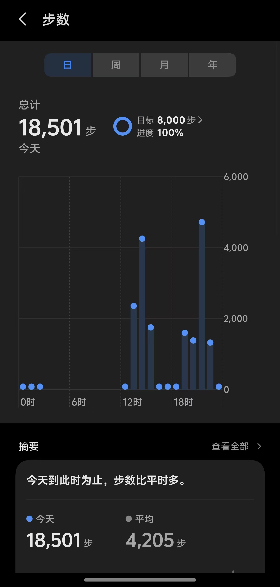

一万八千五百步……真的好累啊……

## 周日

### 比赛

对不起，虽然马上就要比赛了，但我并没有好好地休息，反而很晚才睡觉。  
迷迷糊糊之间，我听到手机好像在响动。摸到手机打开，发现是佩奇师兄的电话。  
天呐！已经七点半了！如果不是师兄的电话我可能会一直睡下去…… 赶紧敲门把隔壁的两个队友叫醒。  
周六晚上已经收拾好东西了，洗漱一下就拉着行李下楼，退好房间，把行李寄存到前台，出发去比赛场地。

华南赛区晋级区域复赛的队伍是所有赛区里最多的，将近八百人要在同一个场地里竞赛。  
我们赶到场地的时候，已经有不少队伍在门口了。大家都在排长队入场。

选手很多，而场地不算很大，而且没有空调。主办方在场地的四周布置了风机，但我的位置在场地的中央，没有风机可以吹到这里。  
燥热，燥热。比赛的时间是七个小时，这期间有将近八百人在同一片空间里呼吸。身边的空气逐渐变得湿热，我甚至感到粘腻。  
比赛的题目不多，但是好难，至少对我来说，这些题目超出了我的能力。  
有一个 AI 的题目，方向是提示词注入。因为其他的题目我都不会做（对不起，我接下来一定努力提升自己），所以我只好来和这个 AI 聊聊天。  
其实提示词注入这个方面，我也没有具体的了解过，所以我真的就只是想着和这个 AI 聊聊天。  
不过这个 AI 似乎不太聪明，哪怕是我也能骗 ta 给出 flag 。  
当我输入 flag 并且通过验证的时候，我小小的兴奋了一下 —— 至少没有爆零！  
真的，我原本认为我们队伍很有可能爆零的。

出了那一道提示词注入之后，我们虽然也有尝试继续在其他题目努力，可惜都没有成功。  
到了比赛的最后一两个小时，我们都觉得再也做不了什么了。  
我其实有点困，本来想要趴着睡一下，但是太热了，热醒了。  
我带了扇子，虽然不能说十分有用，但也聊胜于无了。  
我一边扇着扇子一边发呆，无意间听到我右边的选手因为打游戏被志愿者叫住了，而他们的另外一个队友一直在看番。  
我再看看四周，好像大家已经开始自己做自己的事情了。  
最后的一个小时，我看到有一个选手在玩一款格斗游戏。我本来以为是《街霸6》，但是好像不是。  
我也实在无聊了，打开 steam 开了一局杀戮尖塔2。  
唉，比赛做不出来就算了，爬塔也输了。 A10 怎么这么难。

### 结束

比赛结束之后，我们在原地等待闭幕式和颁奖。  
这期间我拍了两张场地的照片。  

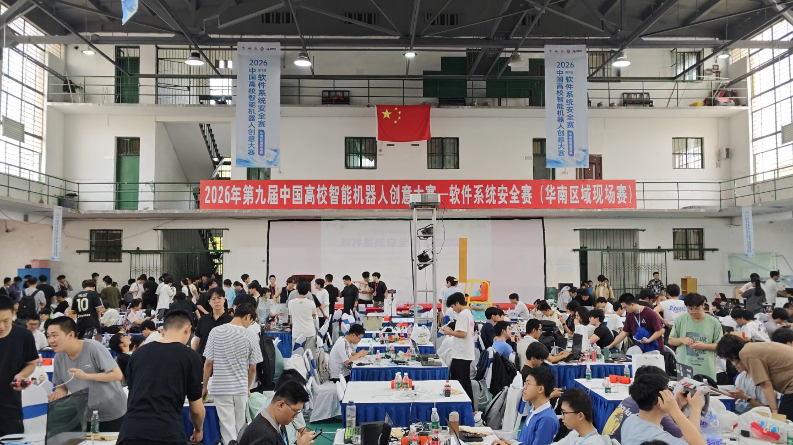

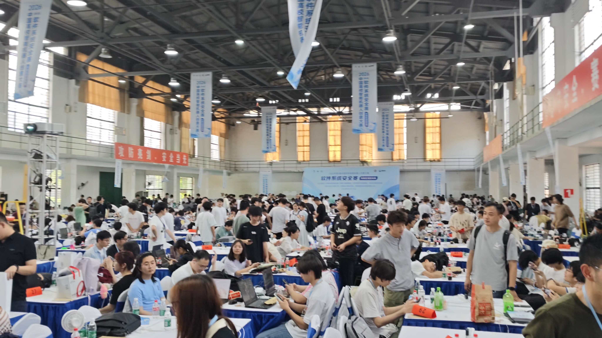

真的很多人。

感觉有一点点失败啊，跨越七百公里来到这里，只能做出最简单的题目。  
不过，无论如何，我在这里拿到了我人生中第一个参赛证。  

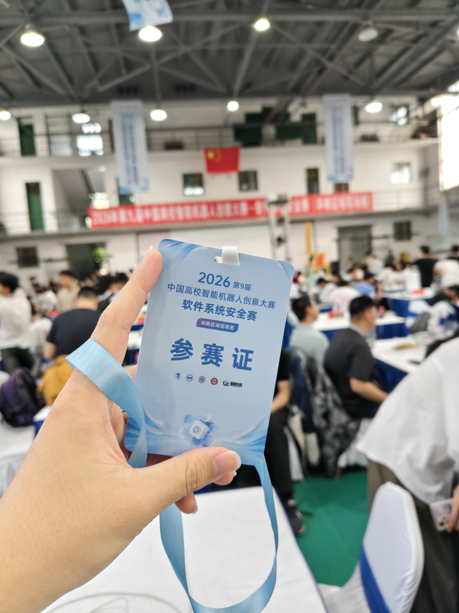

这次失败了，那就继续加油吧！有了第一个参赛证，相信我一定还能有第二个，第三个。  
我知道我的路还很长，没关系，慢慢走吧。

### 返程

比赛结束之后就要收拾东西准备回学校了。我们的时间不算宽裕，所以没有吃晚饭。回到酒店坐了一下就打车去湘潭北站了。  
在候车室休息的时候，大家一起留下了这张照片。

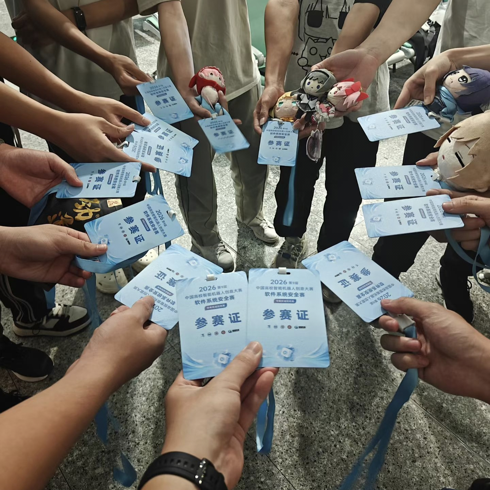

师兄说这是我们工作室参赛人数最多的一次比赛。

七百公里实在太远，哪怕是高铁也要不少的时间。  
在燥热的体训馆里坐七个小时绝对不能说轻松，来回奔波也是一件很辛苦的事情。我想我真的有些累了，在高铁上忍不住睡了一会。  
等我们到广州南站的时候，已经是晚上十点十分。  
出站，转地铁，一路坐到大学城南，再打车到西区，已经十一点半了。  
当我拖着行李箱下车的时候，看到灯火通明门口的五饭，看到三五成群的人们和路灯下的烟火。

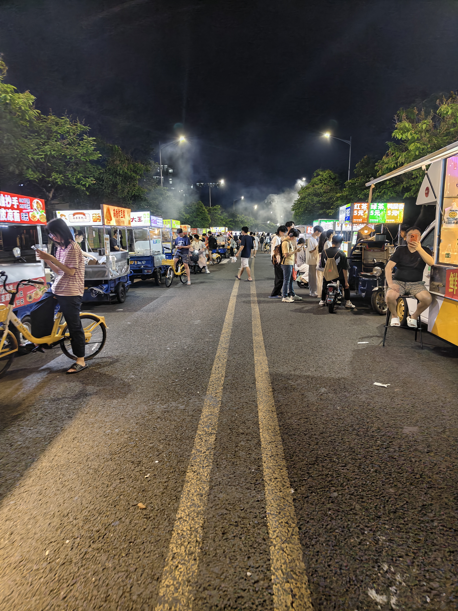

广工，我回来了，我两手空空的回来了……  
别怪我，我总得回家。
